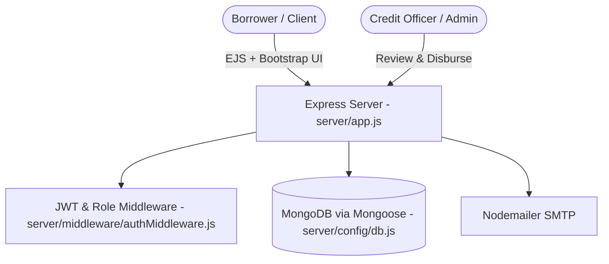

# Micro Finance Management System — Loan Origination & Banking Portal

> Full-stack Node.js, Express, MongoDB/Mongoose, and EJS web platform for loan applications, KYC onboarding, credit officer underwriting, repayment scheduling, and email alerts.

[](https://nodejs.org/)
[](https://expressjs.com/)
[](https://www.mongodb.com/)
[](https://getbootstrap.com/)

---

## Executive Overview

**Micro Finance Management System** (`microfinance`) digitizes micro-lending workflows including customer onboarding, KYC verification, loan eligibility and amortization calculation, staff/admin credit review, repayment tracking, and Nodemailer SMTP notifications.

> **Open Security Remediation Pull Requests (`main` vs. PRs #1, #3, #4):**
> - **PR #1 (`security/remove-seeded-passwords`, Draft):** Removes source-controlled default staff passwords and enforces >=16-character `SEED_*_PASSWORD` environment variables during initial seeding; hardens password reset tokens, auth rate limiting, and IDOR access guards; commits `package-lock.json` and updates `express-rate-limit` / `nodemailer`; adds `npm test` (`tests/security-hardening.test.js`) and `.github/workflows/quality.yml` (verified passing in CI with 9/9 Node tests, 0 high/critical `npm audit` findings, syntax check, and EJS template compilation).
> - **PR #3 (`security/notification-xss`, Draft):** Escapes dynamic HTML rendered inside client notification feeds (`public/js/notifications.js`).
> - **PR #4 (`security/dashboard-html-escaping`, Draft):** Escapes dynamic HTML content rendered across loan dashboard views.

---

## Core Capabilities & Architecture

### Implemented Capabilities
- **Borrower Portal:** Loan application flows, customer profiles, repayment breakdowns, and status views rendered via EJS + Bootstrap 5.
- **Staff / Admin Underwriting:** Multi-role credit review and approval/rejection workflows (`server/controllers/adminController.js`, `loanController.js`, `customerController.js`, `authController.js`).
- **Mongoose Persistence:** Models for users/staff, customers, loan products, loan applications, repayments, and notifications.
- **Transactional Emails:** Nodemailer SMTP notifications for status changes and password recovery workflows.



---

## Directory Structure

```text
microfinance/
├── .github/workflows/quality.yml   # npm ci --ignore-scripts, npm audit, tests, syntax & EJS compile (PR #1)
├── public/
│   ├── css/                        # style.css, feedback.css
│   └── js/                         # main.js, notifications.js, registration-validation.js
├── server/
│   ├── config/db.js                # MongoDB connection
│   ├── controllers/                # admin, auth, customer, loan controllers
│   ├── middleware/authMiddleware.js
│   ├── models/                     # Mongoose schemas
│   ├── routes/                     # Express routes
│   ├── utils/                      # seedAdmin.js, seedLoans.js, mail helpers
│   ├── app.js                      # Express app setup
│   └── server.js                   # Server entrypoint
├── tests/
│   └── security-hardening.test.js  # Node test suite (PR #1)
├── views/                          # EJS templates
├── .env.example                    # Placeholder environment configuration
├── package-lock.json               # Committed dependency lockfile (PR #1)
├── package.json
└── README.md
```

---

## Setup, Environment & Verification

### Installation & First Run
```bash
git clone https://github.com/StratagemVX/microfinance.git
cd microfinance

npm ci --ignore-scripts
cp .env.example .env
# Populate .env with your MongoDB URI, unique JWT_SECRET, and deployment settings
npm start
```
Default port: `5000` (`PORT` in `.env`).

### Environment Variables (`.env.example`)
| Variable | Purpose |
|---|---|
| `MONGODB_URI` | MongoDB connection string |
| `APP_BASE_URL` | Public base URL used for password-reset links |
| `JWT_SECRET` | High-entropy JWT signing secret |
| `JWT_EXPIRY` | Token lifetime (e.g., `7d`) |
| `PORT`, `NODE_ENV` | Express server port (`5000`) & runtime mode |
| `SEED_SUPER_ADMIN_PASSWORD`, `SEED_LOAN_OFFICER_PASSWORD`, `SEED_COMPLIANCE_OFFICER_PASSWORD`, `SEED_CUSTOMER_SERVICE_PASSWORD` | Required >=16-char unique passwords when running `npm run seed:admin` against an empty database (enforced in PR #1) |

### Available Package Scripts (`package.json`)
| Script | Command | Notes |
|---|---|---|
| `npm start` | `node server/server.js` | Production server start |
| `npm run dev` | `nodemon server/server.js` | Development auto-reload server |
| `npm run seed:admin` | `node server/utils/seedAdmin.js` | Seed initial staff accounts when DB has none |
| `npm run seed:loans` | `node server/utils/seedLoans.js` | Seed loan product definitions |
| `npm test` | `node --test tests/*.test.js` | Security & functional tests (added in PR #1) |

---

## Additional Repository Documentation

- [QUICKSTART.md](QUICKSTART.md), [PROJECT_STRUCTURE.md](PROJECT_STRUCTURE.md), [LOAN_PRODUCTS_DETAILS.md](LOAN_PRODUCTS_DETAILS.md)
- [README_EMAIL.md](README_EMAIL.md), [README_FORGOT_PASSWORD.md](README_FORGOT_PASSWORD.md), [TROUBLESHOOTING_EMAIL.md](TROUBLESHOOTING_EMAIL.md)

---

## Contributor Attribution & Profile

- **Lead Engineer:** Chethan Kumar B S (`StratagemVX`)
- **GitHub:** [https://github.com/StratagemVX](https://github.com/StratagemVX)
- **Portfolio:** [https://chethan-kumar-portfolio.vercel.app/](https://chethan-kumar-portfolio.vercel.app/)
- **LinkedIn:** [https://linkedin.com/in/chethan-kumar-b-s-781a002bb](https://linkedin.com/in/chethan-kumar-b-s-781a002bb)
