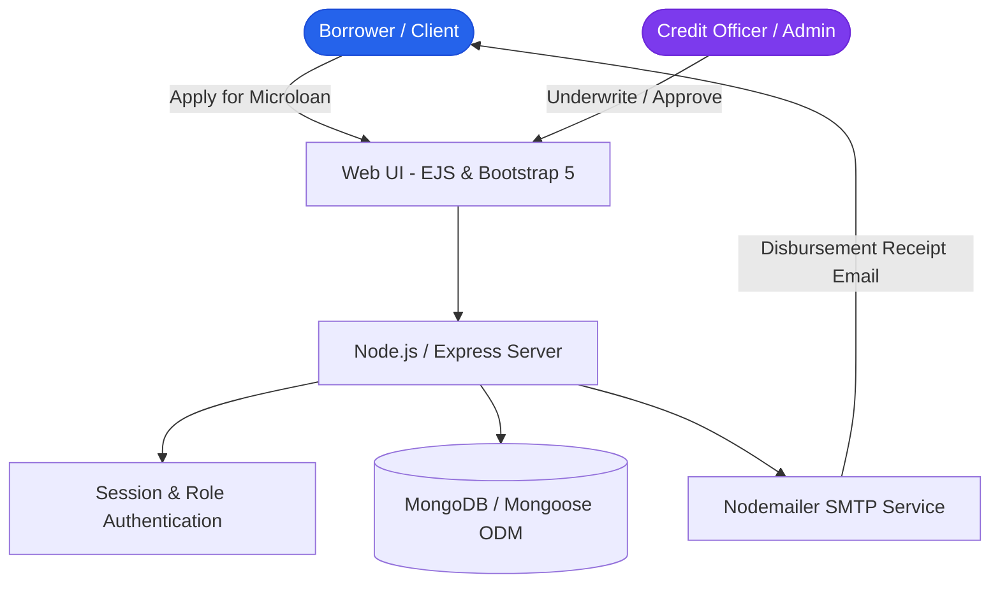

# Micro Finance Management System — Full-Stack Loan Origination & Client Banking Portal

> A comprehensive banking workflow engine digitizing microcredit operations, borrower risk underwriting, automated amortization schedules, and transactional notifications.

[](https://nodejs.org/)
[](https://expressjs.com/)
[](https://www.mongodb.com/)
[](https://getbootstrap.com/)

---

## Executive Overview

Micro Finance Management System is an end-to-end financial operations platform engineered to digitize small-loan origination and credit servicing for community development financial institutions (CDFIs) and underserved micro-entrepreneurs. The system automates the complete credit lifecycle: client onboarding, KYC profile verification, loan eligibility calculation, multi-stage approval workflows, installment repayment scheduling, and automated email receipts.

---

## Core Capabilities & Features

### Implemented Features
- **Borrower Self-Service Portal:** Transparent loan application forms, instant amortization calculators, and real-time application tracking.
- **Credit Officer & Admin Review Dashboard:** Risk profile evaluation, credit limit adjustment, and approval/rejection decision workflows.
- **Amortization & Repayment Scheduling:** Generates principal and interest breakdowns with due-date compliance matrices.
- **Transactional Notification Engine:** Robust SMTP email delivery via Nodemailer sending disbursement receipts and due-date alerts.
- **Relational Data Modeling with Mongoose:** Clean schema separation across Client Profiles, Loan Accounts, Payment Ledgers, and System Audit Logs.

---

## System Architecture



---

## Directory Structure

```text
microfinance/
├── public/                  # CSS stylesheets, client-side validation scripts
├── views/                   # EJS templates (loan application, admin portal, receipts)
├── routes/                  # Express controllers for loans, auth, and clients
├── models/                  # Mongoose schemas (Client, Loan, Payment, User)
├── config/                  # Database connectivity and mailer configuration
├── .env.example             # Clean environment variable specification
├── package.json             # Node dependencies and execution scripts
└── README.md                # Master repository technical documentation
```

---

## Setup & Installation

```bash
# Clone the repository
git clone https://github.com/StratagemVX/microfinance.git
cd microfinance

# Install dependencies
npm install

# Configure environment variables
cp .env.example .env

# Start application server
npm start
```
Default application port: `http://localhost:3000`

---

## Contributor Attribution & Profile

- **Lead Engineer:** Chethan Kumar B S (`StratagemVX`)
- **Institution:** Department of Computer Science & Engineering, MVJ College of Engineering
- **GitHub:** [https://github.com/StratagemVX](https://github.com/StratagemVX)
- **Portfolio:** [https://chethan-kumar-portfolio.vercel.app/](https://chethan-kumar-portfolio.vercel.app/)
- **LinkedIn:** [https://linkedin.com/in/chethan-kumar-b-s-781a002bb](https://linkedin.com/in/chethan-kumar-b-s-781a002bb)
